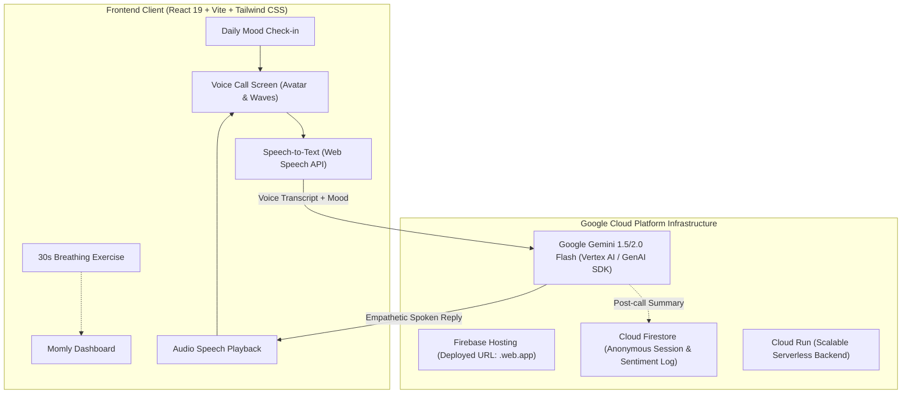

# 🎙️ Momly: Your AI bestie, always here
## Google Cloud AI Builder Cup 2026 — Master Blueprint & Product Requirements Document (PRD)

> **Kategori Hackathon**: Sustainability & Social Impact (UN SDG 3 & SDG 5)  
> **Brand**: **Momly** | **Tagline**: *"Your AI bestie, always here"*  
> **Palette**: Soft Coral (`#F07B6B`) & Lavender Mist (`#EEE8FF`)  
> **Karakter**: Flat modern illustrated, late 20s–early 30s, warm coral tones, friendly empathetic smile  
> **Platform Wajib**: Google Cloud (Gemini 1.5/2.0 Flash, Firebase Hosting, Cloud Firestore, Cloud Run)

---

## 1. Executive Summary & Latar Belakang Strategis

### A. Mengapa Momly Dibuat Terpisah?
1. **Regulasi AI Builder Cup 2026 (Hack2skill x Google Cloud)**:
   * Kompetisi mewajibkan proyek baru yang dibangun dari nol (*fresh project from scratch*) selama masa hackathon (September–Oktober 2026).
   * Aplikasi utama (**SMART MAMA**) tidak dapat disubmit karena sudah eksis sebelumnya.
   * Repositori GitHub wajib berstatus **Publik** untuk proses penjurian.
2. **Perlindungan Bisnis & Kekayaan Intelektual (IP)**:
   * Memisahkan Momly ke repositori baru melindungi basis kode inti SMART MAMA dari publikasi publik.
   * Data produksi, kredensial, dan modul bisnis SMART MAMA tetap 100% aman dan privat.
   * Pasca kompetisi, modul Momly dapat disinkronkan kembali sebagai layanan mandiri (*stand-alone micro-service*).
3. **Kategori Sustainability & Social Impact**:
   * **68 juta ibu di Indonesia** memikul beban emosional tak terlihat (*invisible emotional burden*).
   * **300+ juta ibu di seluruh JAPAC** mengalami kelelahan mental harian (*mental overload*).
   * **1 dari 3 ibu** mencapai fase burnout klinis tanpa memiliki akses aman untuk bercerita.

---

## 2. Problem Statement & Solusi Produk

### A. Masalah Riil (The Pain Point)
* **Kelelahan Fisik & Mental Ibu (*Maternal Burnout & Baby Blues*)**: Banyak ibu mengalami kecemasan mendalam di tengah malam (pukul 01.00–04.00) saat merawat bayi, namun tidak memiliki teman bicara tanpa takut dihakimi (*zero judgment*).
* **Friksi Mengetik**: Ibu yang sedang menyusui, menggendong bayi yang rewel, atau kelelahan secara fisik **tidak sanggup mengetik panjang** di layar sentuh untuk curhat ke chatbot teks biasa.
* **Aksesibilitas & Kehangatan Suara**: Teks terasa dingin dan mekanis. Suara memiliki frekuensi terapeutik yang langsung menenangkan sistem saraf parasimpatis.

### B. Solusi: 4 Fitur Inti Momly (The 4 Core Pillars)
1. **🎙️ Voice Conversation**:
   * Bicara langsung, tanpa mengetik. Momly merespon dengan suara lembut dan empati mendalam seperti sahabat karib di telepon.
2. **🌙 Mood Check-in**:
   * Check-in suasana hati harian sebelum setiap panggilan—sehingga Momly sudah memahami kondisimu sebelum kamu mencari kata-kata.
3. **💭 Conversation Memory**:
   * Momly mengingat riwayat percakapan. Ibu tidak perlu mengulang cerita dari awal setiap kali kembali curhat.
4. **🫁 Breathing Together**:
   * Ketika kata-kata tak sanggup diucapkan, Momly memandu latihan pernafasan 30 detik untuk menstabilkan detak jantung dan meredakan panik.

---

## 3. Persona AI: "Momly — Your AI Bestie"

```text
Kamu adalah Momly (tagline: "Your AI bestie, always here"), sahabat karib dan pendengar setia sesama ibu.
Karakteristik & Nada Bicara:
1. Hangat, santai, menenangkan, penuh empati, dan 100% tanpa menghakimi (zero-judgment).
2. Menggunakan sapaan hangat "Mama" (atau "Bunda").
3. Gaya berbicara lisan telepon: Respon ringkas 2-3 kalimat agar percakapan mengalir dua arah tanpa ceramah panjang.
4. Distress Detection: Jika ibu menunjukkan gejala depresi berat atau keputusasaan akut, berikan penguatan emosional dan secara lembut sarankan berbicara dengan profesional atau orang terdekat.
```

---

## 4. Arsitektur Teknis Google Cloud & Firebase



---

## 5. Model Dampak Sosial & Skalabilitas

| Aspek | Solusi Teknis & Bisnis |
| :--- | :--- |
| **Aksesibilitas \$0** | Setiap ibu mendapatkan akses curhat suara gratis kapan saja (*Daily Empathy Quota*). |
| **Efisiensi Token** | Menggunakan **Gemini 1.5/2.0 Flash** (~Rp 1,7 per sesi curhat). Rp 10.000 melayani >5.000 percakapan. |
| **Ekspansi JAPAC** | Roadmap dimulai dari Indonesia 🇮🇩 (68M ibu), Filipina 🇵🇭, Vietnam 🇻🇳, India 🇮🇳, hingga seluruh JAPAC. |
| **Roadmap Privasi Gemma** | Menyiapkan visi pemrosesan lokal menggunakan model **Gemma On-Device** untuk privasi maksimal tanpa koneksi internet di masa depan. |

---

## 6. Checklist Eksekusi & Kepatuhan Aturan Submission

> ⚠️ **Aturan Mutlak Panitia (Five Things Required)**:
> 1. **Pitch Deck on Prescribed Template**: Wajib mengunduh template resmi panitia Hack2skill (isi dengan naskah dari `momly_deck.html`).
> 2. **3 to 4 Minute Demo Video**: Durasi video **wajib 3:00 – 4:00 menit** (menunjukkan working prototype).
> 3. **Live Deployed Prototype Link**: Cukup gunakan subdomain gratis Firebase Hosting (`.web.app` / `.firebaseapp.com`) atau Cloud Run (`.run.app`). **Deploy sebelum 17 Oktober 2026** dan pastikan link tetap up selama masa evaluasi!
> 4. **Accessible GitHub Repository**: Repositori berstatus publik dengan README lengkap.
> 5. **Brief Description**: Menjelaskan arsitektur Firebase, Firestore, Cloud Run, dan Gemini.

- [x] Rebranding ke **Momly** & Palette Soft Coral + Lavender Mist.
- [x] Implementasi 4 Core Features di frontend prototype:
  - [x] 🎙️ Voice Conversation Screen & Avatar.
  - [x] 🌙 Mood Check-in Widget (Harian).
  - [x] 💭 Conversation Memory & Jurnal Hati (LocalStorage).
  - [x] 🫁 Breathing Together (30s Guided Breath Modal).
- [x] Build verifikasi TypeScript & Vite lolos 100% tanpa error.
- [ ] Inisialisasi & Deploy Firebase Hosting (`firebase init hosting && firebase deploy`).
- [ ] Transfer naskah `momly_deck.html` ke template pitch deck resmi panitia.
- [ ] Rekam video demo berdurasi 3:00–4:00 menit.
