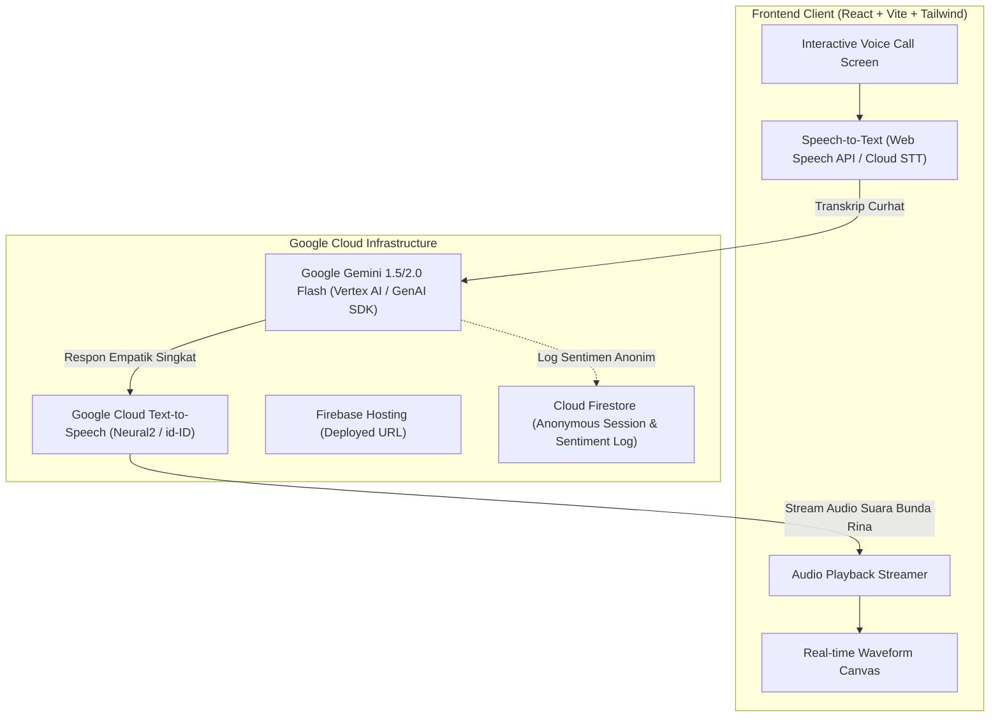

# 🎙️ SUPER MAMA: AI Voice Companion for Maternal Well-being
## Google Cloud AI Builder Cup 2026 — Master Blueprint & Context Transfer

> **Dokumen Transfer Konteks & PRD**: Berkas ini mendokumentasikan seluruh hasil *brainstorming*, latar belakang strategis, arsitektur teknis, dan persona produk untuk proyek **SUPER MAMA** agar dapat langsung dilanjutkan di workspace ini.

---

## 1. Executive Summary & Latar Belakang Strategis

### A. Mengapa Proyek Ini Dibuat Terpisah?
1. **Regulasi AI Builder Cup 2026 (Hack2skill x Google Cloud)**:
   * Kompetisi mewajibkan proyek baru yang dibangun dari nol (*fresh project from scratch*) selama masa hackathon (September–Oktober 2026).
   * Aplikasi utama (**SMART MAMA**) tidak dapat disubmit karena sudah eksis sebelumnya.
   * Repositori GitHub wajib berstatus **Publik** untuk proses penjurian.
2. **Perlindungan Bisnis & Kekayaan Intelektual (IP)**:
   * Memisahkan Super Mama ke repositori baru melindungi basis kode inti SMART MAMA dari publikasi publik.
   * Data produksi, kredensial, dan modul bisnis SMART MAMA tetap 100% aman dan privat.
   * Pasca kompetisi (atau setelah penjurian berakhir), Super Mama dapat diintegrasikan kembali ke SMART MAMA sebagai modul fitur panggilan suara atau layanan mandiri (*stand-alone micro-service*).
3. **Fokus pada Dampak Ekstrem & Sisa Waktu 5 Hari**:
   * Batas akhir pengumpulan (*submission deadline*) adalah **18 Oktober 2026**.
   * Membangun aplikasi suara terfokus (*voice-first AI companion*) jauh lebih cepat, stabil, dan memiliki daya kejut (*wow factor*) yang tinggi di hadapan juri Google Cloud daripada sekadar chatbot teks umum.

---

## 2. Problem Statement & Solusi Produk

### A. Masalah Riil (The Pain Point)
* **Kelelahan Fisik & Mental Ibu (*Maternal Burnout & Baby Blues*)**: Banyak ibu mengalami kecemasan mendalam di malam hari (pukul 01.00–04.00) saat merawat bayi, namun tidak memiliki teman bicara tanpa takut dihakimi (*zero judgment*).
* **Friksi Mengetik**: Ibu yang sedang menyusui, menggendong bayi yang rewel, atau kelelahan secara fisik **tidak sanggup mengetik panjang** di layar sentuh untuk curhat ke chatbot teks biasa.
* **Aksesibilitas & Kehangatan Manusiawi**: Teks sering kali terasa dingin dan kaku. Suara memiliki frekuensi terapeutik (*therapeutic vocal warmth*) yang langsung menenangkan sistem saraf parasimpatis.

### B. Solusi: "Telepon Curhat Sahabat Mama" (Super Mama)
Super Mama menghadirkan pengalaman antarmuka panggilan telepon langsung (Voice Call UI):
* Cukup satu ketukan: *"Telepon Sahabat Mama"*.
* Ibu langsung berbicara dengan bebas menggunakan suara.
* Didengarkan oleh AI dengan empati mendalam, dan dijawab langsung dengan suara lembut berbahasa Indonesia layaknya sedang menelepon sahabat karib / konselor keluarga.

---

## 3. Persona AI: "Bunda Rina — Sahabat Mama"

```text
Kamu adalah Bunda Rina, sahabat karib dan pendengar setia sesama ibu.
Karakteristik & Nada Bicara:
1. Hangat, santai, menenangkan, penuh empati, dan tidak pernah menghakimi.
2. Menggunakan bahasa Indonesia yang akrab (panggilan "Bunda" atau "Mama", kata sapaan hangat seperti "Sabar ya Bun...", "Aku dengar kok...", "Peluk hangat dari jauh").
3. Gaya berbicara lisan (conversational): Berikan respon ringkas 2-3 kalimat agar percakapan telepon mengalir dua arah dan tidak terasa seperti membaca artikel ceramah panjang.
4. Mampu mendeteksi tanda bahaya (Distress Detection): Jika ibu menunjukkan gejala depresi berat atau keputusasaan akut, berikan penguatan emosional dan secara lembut sarankan berbicara dengan profesional atau orang terdekat.
```

---

## 4. Arsitektur Teknis Google Cloud & Firebase



---

## 5. Model Bisnis & Skalabilitas Biaya

| Aspek | Solusi Teknis & Bisnis |
| :--- | :--- |
| **Aksesibilitas Gratis** | Setiap ibu mendapatkan **10 menit curhat suara gratis per hari** (*Daily Empathy Quota*). |
| **Efisiensi Token** | Menggunakan **Gemini 1.5/2.0 Flash** (~Rp 1,7 per sesi curhat). Rp 10.000 melayani >5.000 percakapan. |
| **Konversi Masa Depan** | Pengguna yang membutuhkan sesi tanpa batas dan rekap jurnal emosi mingguan dapat terhubung ke ekosistem langganan SMART MAMA. |
| **Roadmap Privasi (Nilai Tambah Juri)** | Menyiapkan visi pemrosesan lokal menggunakan model keluarga **Gemma** (*On-Device Gemma*) untuk privasi maksimal tanpa koneksi internet di masa depan. |

---

## 6. Checklist Eksekusi Hackathon (13–18 Oktober 2026)

- [ ] Inisialisasi proyek `supermama` (React + TypeScript + Tailwind + Lucide).
- [ ] Implementasi UI Call Screen (Avatar Bunda Rina, Waveform pulse, Tombol Mute & End Call).
- [ ] Integrasi Speech Recognition (Voice-In).
- [ ] Integrasi Gemini 1.5 Flash dengan Persona "Bunda Rina" (Brain).
- [ ] Integrasi Voice Synthesis (Voice-Out) dengan aksen Indonesia alami.
- [ ] Deployment ke Firebase Hosting (mendapatkan live link URL).
- [ ] Penyusunan Pitch Deck / Solution Deck PDF (7-10 Slide).
- [ ] Pembuatan Video Demo (< 3 Menit) untuk submission Hack2skill.
