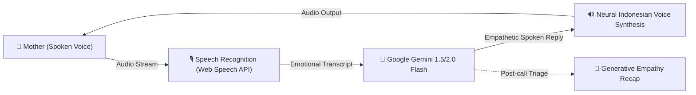

# 🌸 Super Mama: AI Voice Companion for Maternal Well-being
### Developed for Google Cloud AI Builder Cup 2026 (JAPAC) — Powered by Hack2skill

[](https://aibuildercup.com/)
[](https://aistudio.google.com/)
[](https://react.dev/)
[](./LICENSE)

---

## 📖 Overview

**Super Mama** is an empathetic, hands-free, voice-to-voice AI sanctuary specifically engineered for mothers navigating postpartum distress, maternal burnout, and late-night exhaustion.

When holding a crying baby at 3 AM or feeling emotionally overwhelmed, a mother cannot and should not be expected to type lengthy text on a cold smartphone keyboard. **Super Mama allows any mother to tap a single button, speak freely with her natural voice, and be heard and responded to in real-time by "Bunda Rina"**—an empathetic AI companion powered by Google Cloud Gemini.

---

## 🌟 Key Features

1. **🎙️ Voice-In, Voice-Out (Hands-Free Sanctuary)**:
   * End-to-end spoken conversation using browser Speech Recognition and natural neural vocal synthesis.
   * Zero keyboard typing required—ideal for breastfeeding, rocking an infant, or lying down in exhaustion.
2. **🧠 "Bunda Rina" Empathetic Persona**:
   * Powered by **Google Gemini 1.5 / 2.0 Flash**.
   * Culturally attuned to Indonesian maternal psychology, conversational idioms (*"Bunda", "Mama"*, comforting validation), and distress triage.
3. **💌 Post-Call "Surat Cinta untuk Bunda" (Empathy Summary)**:
   * Instant generative post-call emotional validation letter.
   * Automated sentiment reflection and 3 bite-sized actionable micro-relaxation steps.
4. **🔒 100% Anonymous & Zero-Judgment**:
   * No phone number or invasive login needed. Free daily empathy quota ensuring full accessibility.

---

## 🏛️ Architecture



---

## 🚀 Getting Started

### 1. Prerequisites
* Node.js (v20+ recommended)
* Google Gemini API Key (obtain from [Google AI Studio](https://aistudio.google.com/))

### 2. Installation
```bash
# Clone the repository
git clone https://github.com/<your-username>/supermama-ai.git
cd supermama-ai

# Install dependencies
npm install

# Setup environment variables
cp .env.example .env
# Edit .env and enter your VITE_GEMINI_API_KEY
```

### 3. Development Server
```bash
npm run dev
```
Open your browser at `http://localhost:5173`.

### 4. Build for Production & Firebase Deployment
```bash
npm run build
npx firebase deploy --only hosting
```

---

## 📄 License & Intellectual Property Notice

This source code is made publicly available strictly for the evaluation and judging process of the **Google Cloud AI Builder Cup 2026**. All intellectual property and commercial rights are reserved by the author. See [LICENSE](./LICENSE) for details.
