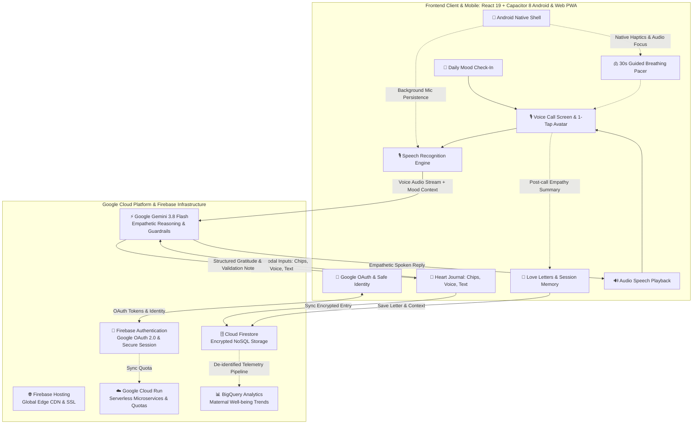

# 🌸 Momly : Mom's Friendly AI Bestie
### Empathetic Voice Companion for Maternal Well-being
**Google Cloud AI Builder Cup 2026 (JAPAC) · Category: Sustainability & Social Impact**

[](https://momly-ai-companion.web.app)
[](https://aibuildercup.com/)
[](https://aistudio.google.com/)
[](https://firebase.google.com/)
[](https://react.dev/)
[](https://capacitorjs.com/)

---

## 👥 Authorship & Team Information

* **Author & Lead**: **Gina Sabrina** (*Nexora Team Leader*)
* **Team**: **Nexora Team**
* **Project**: Momly (: Mom's Friendly AI Bestie)
* **Live Prototype**: [https://momly-ai-companion.web.app](https://momly-ai-companion.web.app)
* **GitHub Repository**: [https://github.com/ginasabrinaasharie-ctrl/momly-ai](https://github.com/ginasabrinaasharie-ctrl/momly-ai)

---

## 📖 Overview

**Momly** is an empathetic, hands-free, voice-first AI companion engineered specifically for mothers navigating maternal burnout, postpartum anxiety, and late-night exhaustion.

In Indonesia alone, **68 million mothers** carry invisible emotional burdens; across JAPAC, **300+ million mothers** experience mental overload daily, with **1 in 3** reaching clinical burnout. At 2 AM, while holding a crying baby or feeling emotionally crushed, an exhausted mother cannot and should not be expected to type long paragraphs on a smartphone screen.

**Momly allows any mother to tap a single button, speak freely with her natural voice, and be heard and supported in real-time by an AI bestie who listens without judgment.**

---

## 🌟 6 Core Pillars of Maternal Well-being

1. **🎙️ Voice Call Companion (Hands-Free Empathetic Voice Chat)**:
   * Talk, don’t type. Momly listens attentively and responds in a gentle, soothing voice with 2-3 sentence conversational turns—preventing cognitive exhaustion at 2 AM.
   * Dynamic avatar emotional states (welcoming, listening, supportive, calm, bestie, understanding) mirroring user emotion in real-time.
2. **📖 Heart Journal (Gratitude & Micro-Wins Tracker)**:
   * 3 flexible input modalities: ⚡ Quick Mood Chips (*"Baby finally ate"*, *"Tired but grateful"*), 🎙️ Voice Recording (*"Exhausted today, but proud of..."*), or ✍️ Written Reflection.
   * Google Gemini Flash automatically parses raw emotion, extracts gratitude items and micro-wins, and crafts an affectionate, personalized validation love note.
3. **💌 Love Letters from Momly (Post-Call Reflections & Memory)**:
   * Epistolary love letters generated after every call session to anchor emotional breakthroughs and provide comfort long after the call ends.
   * Momly preserves contextual memory of past conversations so mothers never have to restart from zero or repeatedly re-explain their vulnerable moments.
4. **🫁 Breathing Break (30-Second Guided Calming Breathing)**:
   * 4-4-4 diaphragmatic breathing visualizer featuring an expanding luminous orb, synchronized audio guidance, and native tactile haptics to regulate the parasympathetic nervous system during acute anxiety or panic.
5. **🌙 Daily Mood Check-In (Emotional Pulse & Empathy Calibration)**:
   * 5-state emotional pulse tracker (*Overwhelmed, Exhausted, Anxious, Neutral, Joyful*) that calibrates Momly's empathy baseline and tone before a call begins.
6. **🔐 Google OAuth & Safe Identity (Privacy-First Data Protection)**:
   * Frictionless 1-tap Google Sign-In via Firebase Auth. Protects personal journal entries, securely manages session history and daily quotas, and personalizes support with strict maternal privacy.

---

## 🛠️ Technology Stack & Architecture

### Frontend & Mobile Experience
* **Framework**: React 19 + TypeScript + Vite
* **Native Mobile Shell**: Capacitor 8 (`@capacitor/android`, `@capacitor/core`, `com.momly.ai`)
* **Styling**: Tailwind CSS v4 (Glassmorphism, warm maternal color palette, fluid micro-interactions)
* **Icons & Visuals**: Lucide React + Custom Emotionally-Expressive Avatars
* **Audio & Speech Engine**:
  * Web Speech Recognition API (continuous STT)
  * Web Audio API (AnalyserNode volume & frequency visualizer)
  * MediaRecorder (audio chunk recording & fallback)
  * HTML5 Audio & SpeechSynthesis (low-latency conversational playback)
  * Android Audio Session Focus (`AUDIOFOCUS_GAIN` prevention of background sleep)
  * Android Native Haptics (tactile vibration pacing for breathing)
* **Deployment**: Web PWA (Firebase Hosting) + Native Android APK (`npm run cap:sync`)

### Google Cloud Platform & Firebase Infrastructure
* **⚡ Google Gemini 3.8 Flash (`@google/genai` v1.29.0 SDK)**:
  * Empathetic voice companion reasoning with strict 2-3 sentence response cadence.
  * Structured JSON schema output generation for Heart Journal gratitude extraction.
  * Real-time maternal distress detection and therapeutic de-escalation guardrails.
* **🔑 Firebase Authentication**:
  * Google OAuth 2.0 Provider (`signInWithPopup`).
  * Frictionless 1-tap authentication preserving user identity across devices.
* **🌐 Firebase Hosting**:
  * Global Google Edge CDN delivering sub-50ms latency.
  * Automated SSL/HTTPS certificates enabling seamless microphone permissions across iOS Safari and Android Chrome.
* **🗄️ Cloud Firestore**:
  * Encrypted NoSQL database storing user profiles, emotional histories, journal entries, and post-call letters.
  * Client-side privacy isolation and anonymous telemetry aggregation.
* **☁️ Google Cloud Run**:
  * Containerized serverless microservices for quota guard and background processing.
* **📊 BigQuery Pipeline**:
  * Longitudinal maternal distress and emotional recovery analytics.

---

## 🏛️ Google Cloud & Firebase Complete Architecture



---

## 🚀 Getting Started

### 1. Prerequisites
* Node.js (v20+ recommended)
* Google Gemini API Key (obtain from [Google AI Studio](https://aistudio.google.com/))
* Firebase Account with Google Cloud Project

### 2. Installation
```bash
# Clone the repository
git clone https://github.com/ginasabrinaasharie-ctrl/momly-ai.git
cd momly-ai

# Install dependencies
npm install

# Setup environment variables
cp .env.example .env
# Edit .env and enter your VITE_GEMINI_API_KEY
```

### 3. Development Server
```bash
npm run dev
```
Open your browser at `http://localhost:5173`.

### 4. Build for Production & Firebase Deployment
```bash
npm run build
npx firebase deploy --only hosting
```
Live production build is automatically deployed to `https://momly-ai-companion.web.app`.

### 5. Native Android App Build (Capacitor)
```bash
# Sync web dist build into Android project
npm run cap:sync

# Open Android Studio project for building APK / Play Store AAB
npm run cap:open
```

---

## 📱 Why We Built a Native Android App with Capacitor?

In Indonesia and across Southeast Asia (JAPAC), **over 85% to 90% of mothers rely on Android smartphones**, predominantly on mid-range and entry-level devices. Deploying natively via Capacitor (`@capacitor/android`) delivers critical advantages from a mother's perspective:

1. **⚡ 1-Tap Home Screen / Lockscreen Access**:
   * At 2 AM, holding a crying infant with one arm and tears in her eyes, a mother cannot navigate browser tabs, type URLs, or handle browser cookie popups. An Android app icon directly on her home screen provides immediate, 1-tap emotional first-aid.
2. **🔇 Uninterrupted Background Audio & Mic Focus**:
   * Mobile web browsers aggressively throttle background tabs or suspend microphone access when the screen turns off to save battery. Momly's native Android container manages OS audio focus (`AUDIOFOCUS_GAIN`), allowing continuous hands-free dialogue even when the phone screen dims in a dark nursery.
3. **📳 Tactile Haptic Pacing for Breathing Break**:
   * In the 30-second Breathing Break, native Android haptics gently vibrate in a 4-4-4 diaphragmatic rhythm. An exhausted mother with tired eyes in a dark room can close her eyes and simply feel the calming rhythm in her palm.
4. **🌐 Digital Inclusion & Low-Spec Performance (UN SDG 10)**:
   * Optimized bundle footprint (<15 MB APK) and efficient memory usage ensure smooth 60 FPS performance even on budget Android devices with limited RAM.
5. **⚙️ Single-Codebase Engineering Velocity**:
   * 100% shared React 19 codebase between web and Android—eliminating dual-team maintenance overhead while delivering full native hardware capabilities.

---

## 🏆 Hackathon Compliance & Submission Checklist

* **Competition**: Google Cloud AI Builder Cup 2026 (JAPAC)
* **Team**: **Nexora Team**
* **Team Leader & Author**: **Gina Sabrina**
* **Category**: Sustainability & Social Impact (UN SDG 3: Good Health & Well-being, SDG 5: Gender Equality, SDG 10: Reduced Inequalities)
* **Primary AI Engine**: Google Gemini 3.8 Flash (`@google/genai` SDK)
* **Mobile & Frontend**: React 19 + TypeScript + Vite + Capacitor 8 Android (`com.momly.ai`)
* **Cloud Infrastructure**: Firebase Hosting + Cloud Firestore + Firebase Authentication + Cloud Run + BigQuery
* **Working Prototype Links**:
  * Web App: [https://momly-ai-companion.web.app](https://momly-ai-companion.web.app)
  * Native Android Build: Package `com.momly.ai` verified on physical Android devices
* **Pitch Deck**: Prepared using the official Hack2skill prescribed template (`Momly Submission _ AI Builder Cup.pptx`)
* **Video Demonstration**: 3 to 4-minute end-to-end working solution walkthrough

---

## 📄 License & Intellectual Property Notice

This source code is made publicly available strictly for the evaluation and judging process of the **Google Cloud AI Builder Cup 2026**. All intellectual property and commercial rights are reserved by **Gina Sabrina (Nexora Team)**. See [LICENSE](./LICENSE) for details.
