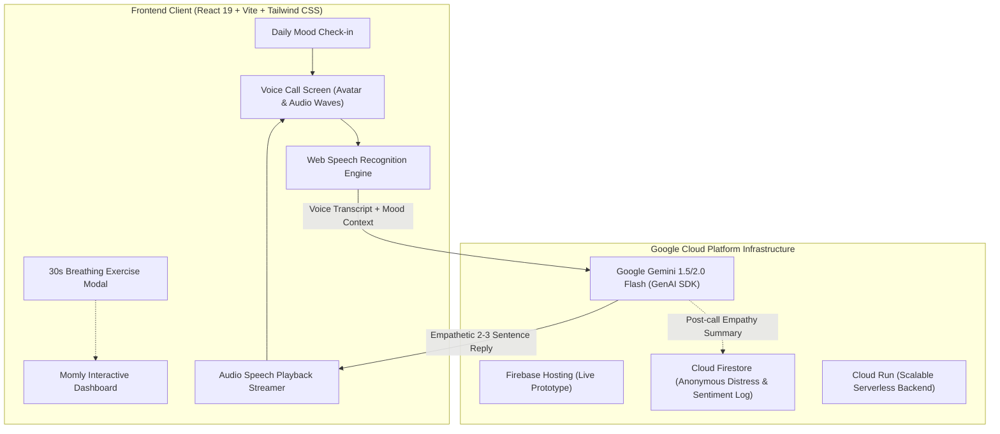

# 🌸 Momly : Mom's Friendly AI Bestie
### Empathetic Voice Companion for Maternal Well-being
**Google Cloud AI Builder Cup 2026 (JAPAC) · Category: Sustainability & Social Impact**

[](https://aibuildercup.com/)
[](https://aistudio.google.com/)
[](https://firebase.google.com/)
[](https://react.dev/)
[](./LICENSE)

---

## 📖 Overview

**Momly** is an empathetic, hands-free, voice-first AI companion engineered specifically for mothers navigating maternal burnout, postpartum anxiety, and late-night exhaustion.

In Indonesia alone, **68 million mothers** carry invisible emotional burdens; across JAPAC, **300+ million mothers** experience mental overload daily, with **1 in 3** reaching clinical burnout. At 2 AM, while holding a crying baby or feeling emotionally crushed, an exhausted mother cannot and should not be expected to type long paragraphs on a smartphone screen.

**Momly allows any mother to tap a single button, speak freely with her natural voice, and be heard and supported in real-time by an AI bestie who listens without judgment.**

---

## 🌟 4 Core Features

1. **🎙️ Voice Conversation**:
   * Talk, don’t type. Momly listens attentively and responds in a gentle, empathetic voice—because on some nights, typing is simply too much.
2. **🌙 Mood Check-in**:
   * A gentle daily emotional pulse before every call—allowing Momly to already understand how you are feeling before you even find the words.
3. **💭 Conversation Memory**:
   * Momly remembers. You never have to explain yourself from scratch again—just pick up where you left off with your bestie.
4. **🫁 Breathing Together**:
   * When words aren't enough, Momly guides an interactive 30-second calming breath exercise to regulate the parasympathetic nervous system during acute anxiety or panic.

---

## 🏛️ Google Cloud & Firebase Architecture



---

## 🚀 Getting Started

### 1. Prerequisites
* Node.js (v20+ recommended)
* Google Gemini API Key (obtain from [Google AI Studio](https://aistudio.google.com/))

### 2. Installation
```bash
# Clone the repository
git clone https://github.com/<your-username>/momly-ai.git
cd momly-ai

# Install dependencies
npm install

# Setup environment variables
cp .env.example .env
# Edit .env and enter your VITE_GEMINI_API_KEY
```

### 3. Development Server
```bash
npm run dev
```
Open your browser at `http://localhost:5173`.

### 4. Build for Production & Firebase Deployment
```bash
npm run build
npx firebase deploy --only hosting
```

---

## 🏆 Hackathon Compliance & Submission Checklist

* **Category**: Sustainability & Social Impact (UN SDG 3: Good Health & Well-being, SDG 5: Gender Equality).
* **AI Engine**: Google Gemini 1.5/2.0 Flash (`@google/genai`).
* **Cloud Infrastructure**: Firebase Hosting + Firestore + Cloud Run serverless.
* **Pitch Deck**: Prepared using the official Hack2skill prescribed template.
* **Video Demonstration**: 3 to 4-minute working solution demo.

---

## 📄 License & Intellectual Property Notice

This source code is made publicly available strictly for the evaluation and judging process of the **Google Cloud AI Builder Cup 2026**. All intellectual property and commercial rights are reserved by the author. See [LICENSE](./LICENSE) for details.
